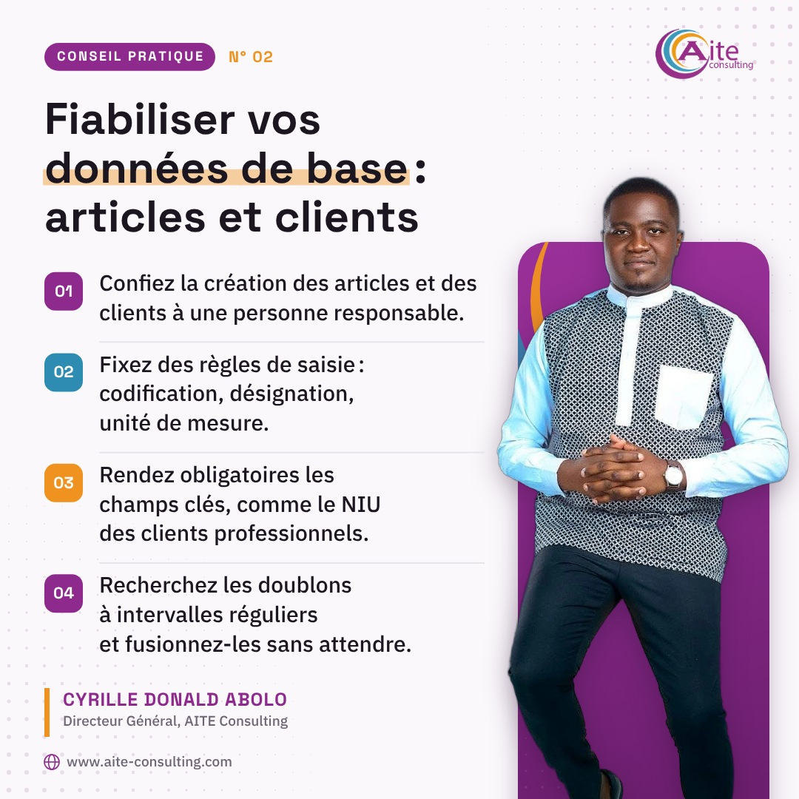
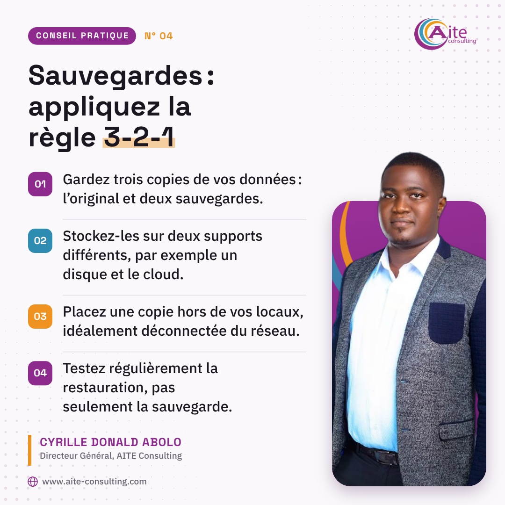
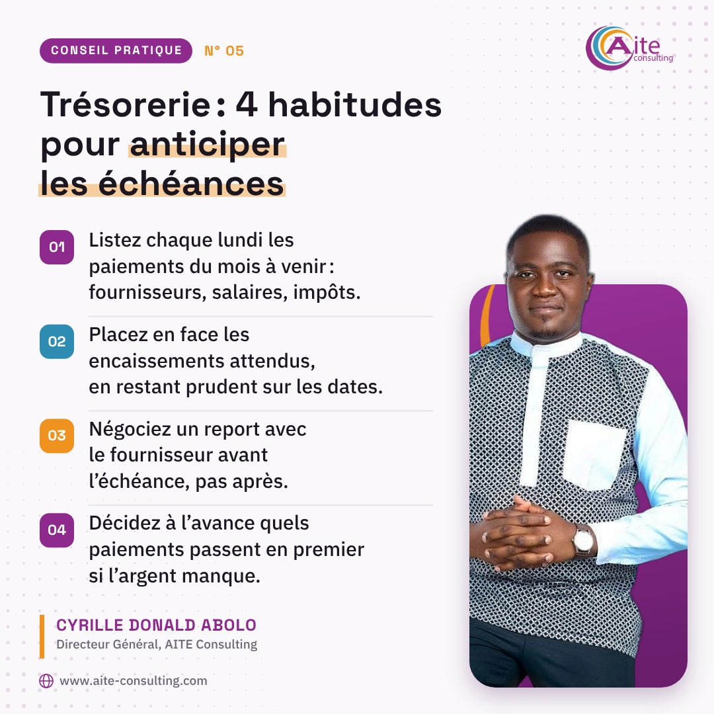
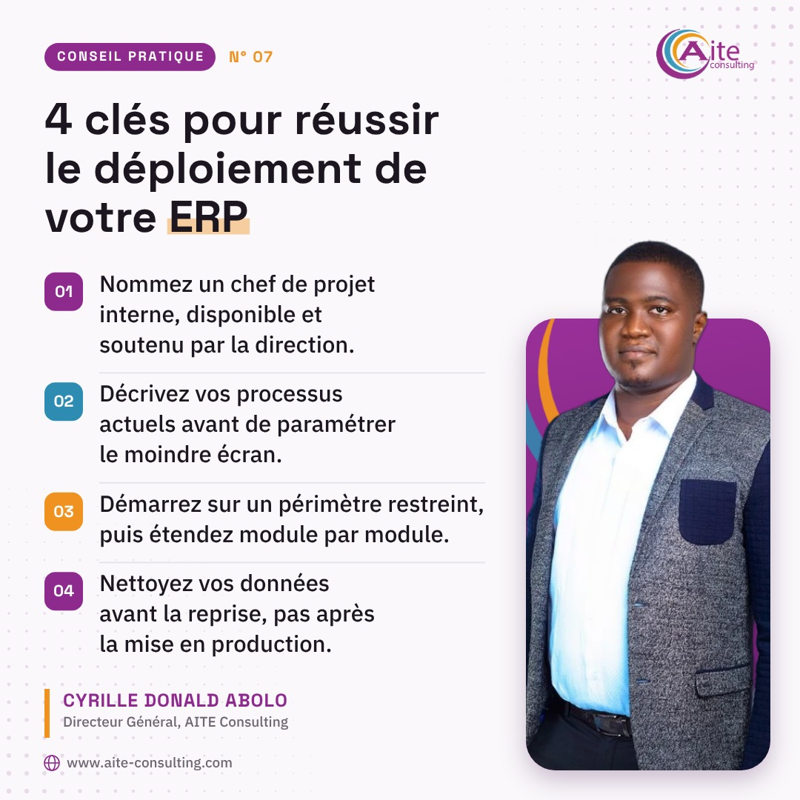
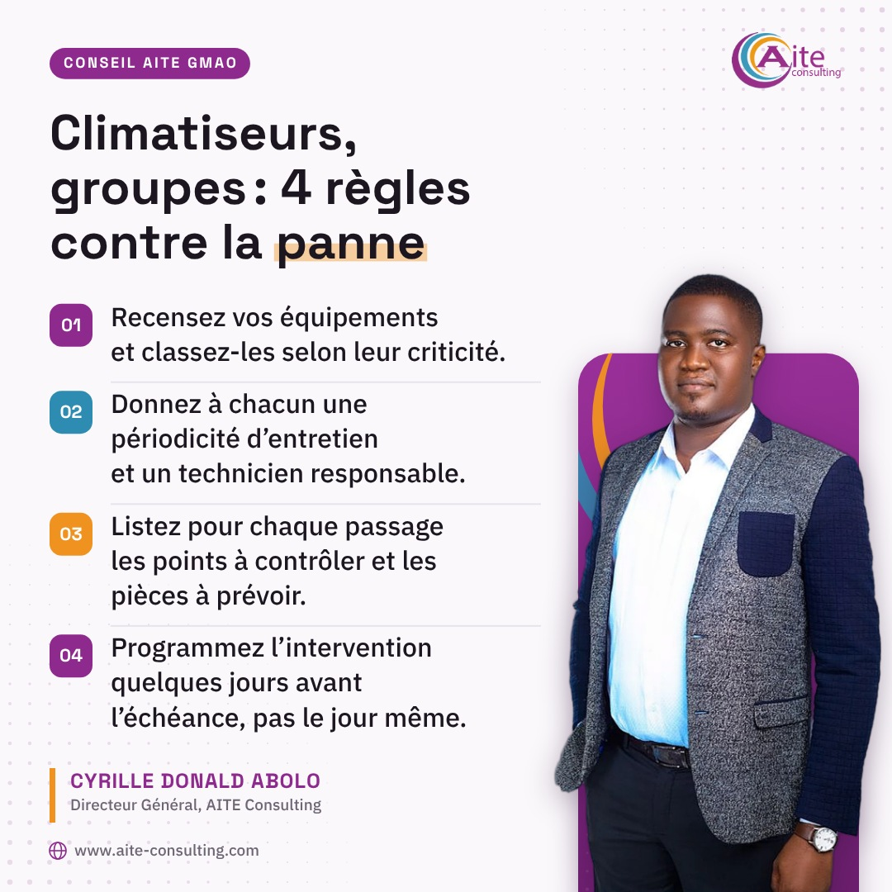
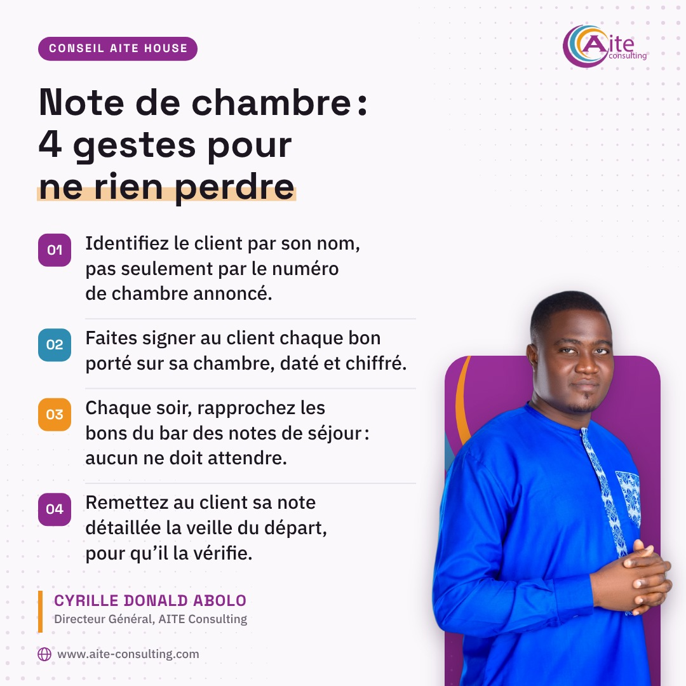
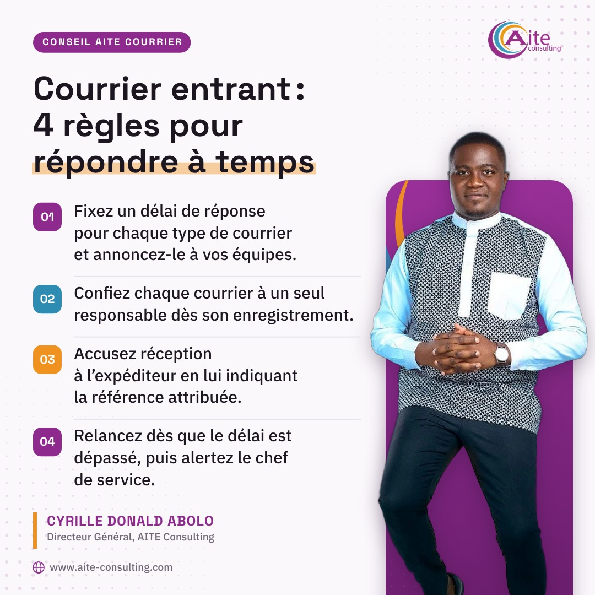

# Calendrier de publication

Généré par `node generer.js` à partir de `contenus/publications.json`. Ne pas modifier à la main.

Rythme proposé : lundi, une affiche de motivation ; mercredi, un conseil pratique ; vendredi, une citation.
Le week-end : détente et sourire le samedi, repos le dimanche.

## Semaine 1

### Lundi — Affiche · action


**Visuel :** Ne cherchez pas l’élan : ouvrez le premier dossier.

**Légende à publier :**

```text
Le lundi matin, on attend souvent d’avoir envie. L’envie vient rarement seule.

J’ai vu des dirigeants passer la matinée à trier leurs messages, ranger leur bureau, relire l’agenda. Le dossier important attendait toujours en bas de la pile. Ce qui débloque la semaine, c’est un geste simple : ouvrir ce dossier, lire la première page, écrire la première ligne. L’élan arrive après, pas avant.

Quel dossier allez-vous ouvrir en premier ce matin ?

#Leadership #Entrepreneuriat #Organisation #PME #AITEConsulting
```

### Mercredi — Conseil · hameçonnage


**Visuel :** 4 gestes pour repérer un e-mail d’hameçonnage

1. Vérifiez l’adresse réelle de l’expéditeur, pas seulement le nom affiché.
2. Survolez les liens avant de cliquer et contrôlez le domaine de destination.
3. Méfiez-vous de l’urgence, des menaces et des gains trop beaux pour être vrais.
4. Confirmez toute demande de virement par un appel à un numéro déjà connu.

**Légende à publier :**

```text
Beaucoup d’attaques ne commencent pas par un piratage sophistiqué. Elles commencent par un e-mail bien imité.

Un fournisseur qui annonce un changement de RIB, un dirigeant qui réclame un virement urgent et confidentiel, une fausse alerte de messagerie qui demande de « confirmer » son mot de passe : le scénario est connu, et il fonctionne parce qu’il joue sur la pression. Dans le doute, la règle est simple : on ne clique pas, on rappelle l’interlocuteur à un numéro déjà connu.

Vos équipes savent-elles à qui signaler un message suspect ?

#AITEConsulting #Cybersecurite #Hameconnage #SecuriteInformatique #PME
```

### Vendredi — Citation · règle d’or


**Visuel :** Chez AITE, nous le répétons : « On ne vend pas de la technologie, on vend la fin d’un problème de gestion. » Avant toute démonstration, nous écrivons le problème à résoudre.

**Légende à publier :**

```text
C’est la règle que nous appliquons chez AITE Consulting, et je la rappelle souvent à mes équipes.

Un gérant d’hôtel ne m’a jamais demandé un ERP. Il voulait savoir, chaque soir, si les chambres occupées et la caisse concordaient. Un DAF, lui, veut une clôture sans nuits blanches. Une DRH veut des bulletins justes, remis à temps.

Partir du problème, c’est la condition pour livrer quelque chose d’utile. Quel problème de gestion aimeriez-vous voir disparaître cette année ?

#AITEConsulting #TransformationDigitale #Gestion #Entrepreneuriat #Cameroun
```

## Semaine 2

### Lundi — Affiche · organisation


**Visuel :** Une tâche sans responsable est une tâche déjà en retard.

**Légende à publier :**

```text
« On va s’en occuper. » Cette phrase m’inquiète toujours. Qui est ce « on » ?

Je l’ai constaté dans des PME comme dans des administrations : la relance d’un fournisseur, la mise à jour du fichier clients, le suivi d’un litige. Chacun pense qu’un collègue s’en charge, et rien ne bouge. Mettez un seul nom en face de chaque tâche, avec une date. L’équipe peut aider, mais une seule personne rend compte.

Combien de tâches sans nom traînent dans votre liste ce matin ?

#Management #Organisation #PME #Leadership #AITEConsulting
```

### Mercredi — Conseil · données de base



**Visuel :** Fiabiliser vos données de base : articles et clients

1. Confiez la création des articles et des clients à une personne responsable.
2. Fixez des règles de saisie : codification, désignation, unité de mesure.
3. Rendez obligatoires les champs clés, comme le NIU des clients professionnels.
4. Recherchez les doublons à intervalles réguliers et fusionnez-les sans attendre.

**Légende à publier :**

```text
Un logiciel de gestion ne corrige pas des données mal saisies. Il les répète, plus vite et partout.

Un même client créé plusieurs fois sous des noms différents, un article enregistré au carton ici et à l’unité là : les états deviennent faux, les relances partent au mauvais endroit, les inventaires ne tombent jamais juste. La solution n’est pas d’abord technique. Elle tient en quelques règles de saisie claires et une personne qui en est garante.

Qui, chez vous, a le droit de créer une fiche client ou article ?

#AITEConsulting #QualiteDesDonnees #ERP #Gestion #PME
```

### Vendredi — Citation · confiance


**Visuel :** Confier un dossier sans donner les moyens de le mener, ce n’est pas faire confiance. C’est préparer un coupable.

**Légende à publier :**

```text
« Je te fais confiance, débrouille-toi. » Cette phrase sonne comme un compliment. Elle cache souvent un abandon.

Confier une mission à un collaborateur, c’est aussi lui donner l’accès aux informations, un budget clair, un délai réaliste et un point d’étape. Sans cela, il porte seul le risque, et l’échec lui sera reproché alors qu’il était prévisible. La vraie confiance se prépare : elle donne les moyens, puis elle laisse faire.

Comment préparez-vous vos collaborateurs avant de leur confier un dossier important ?

#Confiance #Management #Equipe #Leadership #PME
```

## Semaine 3

### Lundi — Affiche · courage


**Visuel :** La décision repoussée coûte plus cher chaque semaine.

**Légende à publier :**

```text
Il y a toujours une bonne raison d’attendre : le budget, le calendrier, l’humeur de l’équipe.

Pendant ce temps, la situation continue. Le collaborateur qui ne tient pas son poste démotive les autres. Le fournisseur peu fiable retarde les livraisons. Le vieux logiciel bricolé produit des erreurs chaque mois. Je ne dis pas qu’il faut décider dans la précipitation. Je dis qu’il faut fixer une date pour décider, et la tenir.

Quelle décision repoussez-vous depuis trop longtemps ?

#Leadership #Entrepreneuriat #Dirigeant #PME #AITEConsulting
```

### Mercredi — Conseil · caisse


**Visuel :** 4 réflexes pour une clôture de caisse fiable

1. Comptez les espèces chaque soir, en présence du caissier et d’un responsable.
2. Comparez espèces et paiements mobiles aux ventes du jour ; notez chaque écart.
3. Faites signer la fiche de clôture par les deux personnes présentes.
4. Gardez un fond de caisse fixe et déposez le surplus au coffre ou en banque.

**Légende à publier :**

```text
Un écart de caisse découvert en fin de mois est presque impossible à expliquer. Découvert le soir même, il s’explique souvent en quelques minutes.

Dans beaucoup d’établissements, la caisse se compte « quand on a le temps ». Le jour où un écart apparaît, personne ne sait plus quel service, quel caissier ni quelle vente sont en cause. La clôture journalière n’est pas une marque de méfiance : c’est une protection pour le caissier honnête autant que pour le patron.

Chez vous, qui compte la caisse le soir, et qui signe ?

#Gestion #PME #Hotellerie #Restauration #Cameroun
```

### Vendredi — Citation · exemplarité


**Visuel :** Si le directeur demande encore ses rapports sur papier, l’équipe comprend vite que le nouvel outil est facultatif. Le premier utilisateur, c’est lui.

**Légende à publier :**

```text
Un nouvel outil s’annonce en réunion. Il s’adopte, ou non, dans le bureau du directeur.

Si vous continuez à demander vos rapports sur papier, à valider les dépenses par message, à appeler pour connaître le stock, le signal est clair : l’ancien système reste la règle. Personne ne fera l’effort à votre place.

Le jour où le dirigeant consulte lui-même ses chiffres dans l’outil et pose ses questions à partir de là, les équipes suivent beaucoup plus vite. Quelle habitude allez-vous changer en premier ?

#AITEConsulting #Leadership #TransformationDigitale #Management #PME
```

## Semaine 4

### Lundi — Affiche · relation client


**Visuel :** Appelez le client mécontent avant qu’il ne parte.

**Légende à publier :**

```text
Un client qui se plaint vous donne encore une chance. Celui qui se tait est souvent déjà en train de partir.

Le réflexe naturel est d’éviter l’appel difficile. On envoie un message écrit, on attend que les choses se calment. J’ai appris l’inverse : appeler soi-même, écouter jusqu’au bout sans se justifier, puis dire précisément ce qui va être fait et quand. Le problème n’est pas toujours réglé à la fin de l’appel, mais la relation est souvent sauvée.

Qui allez-vous appeler en premier ce lundi ?

#RelationClient #Entrepreneuriat #Commerce #PME #AITEConsulting
```

### Mercredi — Conseil · sauvegardes



**Visuel :** Sauvegardes : appliquez la règle 3-2-1

1. Gardez trois copies de vos données : l’original et deux sauvegardes.
2. Stockez-les sur deux supports différents, par exemple un disque et le cloud.
3. Placez une copie hors de vos locaux, idéalement déconnectée du réseau.
4. Testez régulièrement la restauration, pas seulement la sauvegarde.

**Légende à publier :**

```text
Une sauvegarde qui n’a jamais été restaurée reste une hypothèse.

Le jour où un disque lâche ou qu’un rançongiciel chiffre le serveur, on découvre souvent que la copie était sur la même machine, ou branchée en permanence au réseau. La règle 3-2-1 répond à ce risque : trois copies de vos données, sur deux supports différents, dont une hors de vos locaux. Gardez au moins une copie déconnectée, et vérifiez à date fixe que vous savez vraiment restaurer.

À quand remonte votre dernier test de restauration ?

#AITEConsulting #Sauvegarde #Cybersecurite #ContinuiteActivite #PME
```

### Vendredi — Citation · exigence


**Visuel :** L’exigence n’est pas de la dureté. Rendre un travail à reprendre, avec des remarques précises, c’est dire à son auteur : je vous crois capable.

**Légende à publier :**

```text
Certains responsables pensent qu’être bienveillant, c’est laisser passer. Je pense l’inverse.

Quand un rapport arrive incomplet et que je le valide quand même, je dis à son auteur que je n’attends pas mieux de lui. Quand je le lui rends avec des remarques précises et le temps de le reprendre, je lui dis qu’il en est capable. Les collaborateurs que j’ai vus progresser le plus sont ceux à qui l’on a demandé davantage, avec respect.

Pour vous, où passe la frontière entre exigence et dureté ?

#Exigence #Management #Leadership #RessourcesHumaines
```

## Semaine 5

### Lundi — Affiche · terrain


**Visuel :** Allez sur le terrain avant de réécrire la procédure.

**Légende à publier :**

```text
Une procédure écrite dans un bureau ne survit pas toujours au comptoir.

Avant de changer une façon de travailler, je demande à voir le travail réel : la réception d’un hôtel à l’heure des arrivées, le magasin au moment des livraisons, le service courrier un lundi matin. On y découvre les contournements, les cahiers parallèles, les vraies raisons des retards. Chez AITE Consulting, nos projets commencent par ce passage sur le terrain.

Quand avez-vous observé votre terrain pour la dernière fois ?

#Gestion #Organisation #TransformationDigitale #PME #AITEConsulting
```

### Mercredi — Conseil · trésorerie



**Visuel :** Trésorerie : 4 habitudes pour anticiper les échéances

1. Listez chaque lundi les paiements du mois à venir : fournisseurs, salaires, impôts.
2. Placez en face les encaissements attendus, en restant prudent sur les dates.
3. Négociez un report avec le fournisseur avant l’échéance, pas après.
4. Décidez à l’avance quels paiements passent en premier si l’argent manque.

**Légende à publier :**

```text
Une entreprise rentable peut manquer d’argent au mauvais moment. Le problème n’est pas toujours le chiffre d’affaires : c’est le calendrier.

Je rencontre souvent des dirigeants qui découvrent une facture échue le jour où le fournisseur suspend ses livraisons. Ils paient dans l’urgence, au détriment d’un salaire ou d’une taxe. Un simple échéancier, tenu chaque semaine, permet d’anticiper, de négocier à temps et de décider avec la tête froide.

Jusqu’à quelle date voyez-vous clair dans votre trésorerie aujourd’hui ?

#Tresorerie #Finance #PME #Entrepreneuriat #Cameroun
```

### Vendredi — Citation · leadership


**Visuel :** Dans une équipe, quelqu’un doit être le premier à dire « je me suis trompé ». Si ce n’est pas le dirigeant, ce ne sera personne.

**Légende à publier :**

```text
Pour un dirigeant, le plus difficile n’est pas de dire « non ». C’est de dire « je me suis trompé ».

J’ai longtemps cru qu’un chef devait toujours avoir la bonne réponse. Puis j’ai vu des équipes cacher un retard ou une erreur de saisie pendant des semaines, simplement parce que la direction ne reconnaissait jamais les siennes. Le jour où le dirigeant assume devant tous une mauvaise décision, les langues se délient et les problèmes remontent plus tôt.

Et vous, quand avez-vous reconnu une erreur devant votre équipe pour la dernière fois ?

#Leadership #Management #PME #Cameroun #AITEConsulting
```

## Semaine 6

### Lundi — Affiche · reconnaissance


**Visuel :** Commencez la semaine en remerciant quelqu’un de précis.

**Légende à publier :**

```text
« Merci à toute l’équipe » fait plaisir. « Merci pour ce rapprochement bancaire bouclé vendredi » fait grandir.

Avec les années, j’ai appris que la reconnaissance générale s’oublie vite. Celle qui nomme une personne et un travail précis reste. Elle montre aussi à tous ce que l’on attend vraiment. Ce matin, choisissez une personne, un fait concret, et dites-le devant l’équipe ou en tête-à-tête.

Qui allez-vous remercier aujourd’hui, et pour quoi ?

#Leadership #Management #Equipe #RessourcesHumaines #AITEConsulting
```

### Mercredi — Conseil · stocks


**Visuel :** Bar, cuisine : 4 gestes contre le coulage

1. Comptez chaque semaine les articles les plus vendus et les plus chers.
2. Rapprochez les sorties du magasin des ventes enregistrées en caisse.
3. Exigez un bon signé pour toute sortie, offerts et repas du personnel compris.
4. Faites compter le stock par une autre personne que le magasinier.

**Légende à publier :**

```text
Le coulage ne fait pas de bruit. Une bouteille offerte, une portion trop généreuse, un carton jamais enregistré : chaque geste semble anodin, mais la marge disparaît.

J’ai vu plus d’un gérant découvrir le problème au moment de l’inventaire annuel, quand il est trop tard pour en retrouver l’origine. Un comptage régulier des articles sensibles, rapproché des ventes, suffit souvent à remettre de la discipline. Et l’équipe comprend vite que le stock est suivi.

Quel est l’article de votre stock que vous surveillez de plus près ?

#GestionDesStocks #Hotellerie #Restauration #PME #Cameroun
```

### Vendredi — Citation · fichiers éparpillés


**Visuel :** Quand chaque service tient son propre fichier Excel, l’entreprise a plusieurs vérités. Avec une seule base, on cesse de comparer les chiffres et on commence à décider.

**Légende à publier :**

```text
Combien de versions du même chiffre circulent dans votre entreprise ?

Le commercial a son fichier, la comptable a le sien, le magasinier tient un cahier. Chacun est sincère, et pourtant personne n’a le même total. Les réunions tournent au débat sur le bon chiffre, et les décisions attendent. J’ai vu des dirigeants perdre une matinée entière à réconcilier des chiffres qui auraient dû être identiques.

Une base unique ne règle pas tout, mais elle met fin à ce débat. Dans votre organisation, qui détient la version officielle des chiffres ?

#AITEConsulting #TransformationDigitale #Gestion #PME #Cameroun
```

## Semaine 7

### Lundi — Affiche · régularité


**Visuel :** Une entreprise solide se construit lundi après lundi.

**Légende à publier :**

```text
On remarque les grands lancements. On remarque moins les lundis ordinaires, où pourtant tout se joue.

Les entreprises que j’admire ne sont pas celles qui font du bruit. Ce sont celles qui tiennent leurs rituels : le point d’équipe du lundi, le suivi de trésorerie, les relances clients, les sauvegardes vérifiées. Rien de spectaculaire. Mais semaine après semaine, ces habitudes construisent une organisation sur laquelle on peut compter.

Quel rituel du lundi tenez-vous sans exception ?

#Entrepreneuriat #Gestion #PME #Afrique #AITEConsulting
```

### Mercredi — Conseil · ERP



**Visuel :** 4 clés pour réussir le déploiement de votre ERP

1. Nommez un chef de projet interne, disponible et soutenu par la direction.
2. Décrivez vos processus actuels avant de paramétrer le moindre écran.
3. Démarrez sur un périmètre restreint, puis étendez module par module.
4. Nettoyez vos données avant la reprise, pas après la mise en production.

**Légende à publier :**

```text
Un ERP se rate rarement à cause du logiciel. Il se rate dans l’organisation qui l’entoure.

J’ai vu des projets s’enliser parce que personne, en interne, n’avait le temps de trancher. Les utilisateurs attendaient le prestataire, le prestataire attendait les validations, et les vieux fichiers Excel continuaient de tourner en parallèle. Chez AITE, nous demandons désormais un chef de projet interne avant de lancer le moindre paramétrage.

Dans votre entreprise, qui porterait ce rôle dès demain ?

#AITEConsulting #ERP #TransformationDigitale #PME #Gestion
```

### Vendredi — Citation · formation des jeunes


**Visuel :** Un jeune diplômé arrive avec des connaissances. La rigueur, le respect du client et la parole tenue, c’est à nous, dirigeants, de les lui transmettre.

**Légende à publier :**

```text
Chaque année, de jeunes diplômés frappent à la porte de nos entreprises. Ils ont des connaissances. Il leur manque souvent les codes du terrain.

Tenir un délai, répondre à un client mécontent, rédiger un compte rendu clair, signaler une erreur sans attendre : l’école ne peut pas tout enseigner. Cela s’apprend dans l’entreprise, auprès d’aînés qui prennent le temps d’expliquer et de corriger. Ce temps n’est pas une charge. C’est la façon la plus sûre de préparer la relève.

Qui vous a appris le métier à vos débuts ?

#FormationDesJeunes #Transmission #Jeunesse #Leadership #RessourcesHumaines
```

## Semaine 8

### Lundi — Affiche · clarté


**Visuel :** Ce matin, dites à chacun ce que vous attendez de lui. Clairement.

**Légende à publier :**

```text
Beaucoup de déceptions au travail viennent d’attentes jamais dites.

Le responsable pense que c’est évident. Le collaborateur, lui, fait de son mieux avec ce qu’il a compris. À la fin de la semaine, chacun est frustré. J’ai pris l’habitude de préciser le résultat attendu, le délai et le moment où nous ferons le point. Cela prend quelques minutes le lundi et évite bien des malentendus le vendredi.

Vos collaborateurs savent-ils exactement ce que vous attendez d’eux cette semaine ?

#Management #Leadership #Equipe #PME #AITEConsulting
```

### Mercredi — Conseil · pilotage


**Visuel :** 4 règles pour un tableau de bord qui fait décider

1. Limitez-vous aux indicateurs qui déclenchent une décision.
2. Suivez chaque semaine ventes, encaissements, trésorerie et créances.
3. Comparez chaque chiffre à un objectif ou à la période précédente.
4. Fixez un jour et une heure de lecture, et tenez ce rendez-vous.

**Légende à publier :**

```text
Découvrir ses résultats au bilan, des mois plus tard, c’est apprendre trop tard ce que l’on pouvait encore corriger.

Un dirigeant de PME n’a pas besoin d’un rapport épais. Il a besoin de quelques chiffres fiables, lus à date fixe, qui l’obligent à décider. Un ERP comme Odoo peut les produire automatiquement. Le choix des indicateurs, lui, reste le travail du dirigeant, pas celui du logiciel.

Quels indicateurs regardez-vous chaque semaine, et lesquels vous manquent ?

#AITEConsulting #Pilotage #TableauDeBord #Odoo #PME #Gestion
```

### Vendredi — Citation · contrôle


**Visuel :** Quand le contrôle repose sur le patron, il part en voyage avec lui. Intégré au système, il devient une règle pour tous, et personne ne le vit comme une attaque.

**Légende à publier :**

```text
Dans beaucoup de PME, le contrôle repose sur une seule personne : le patron.

Quand il est présent, tout va bien. Quand il voyage, les remises s’accordent sans validation, les dépenses passent sans justificatif, les stocks bougent sans bon de sortie. Ce n’est pas forcément de la mauvaise foi. C’est l’absence d’une règle écrite et partagée.

Un circuit de validation intégré au système applique la même règle à tous, tous les jours, même en votre absence. Quel contrôle de votre entreprise dépend encore uniquement de vous ?

#AITEConsulting #ControleInterne #PME #Leadership #Gestion
```

## Semaine 9

### Lundi — Affiche · traçabilité


**Visuel :** Une décision qui n’est pas écrite sera rediscutée jeudi.

**Légende à publier :**

```text
Lundi, on décide. Jeudi, personne ne se souvient de la même chose.

C’est une scène fréquente : une décision prise à l’oral, chacun repart avec sa version, et le sujet revient sur la table quelques jours plus tard. Le temps perdu ne vient pas d’un manque de compétence, mais d’un manque de trace. Un compte rendu court, envoyé le jour même, évite la plupart de ces retours en arrière : ce qui a été décidé, par qui, pour quand.

Qui rédige les comptes rendus dans votre équipe ?

#Management #Organisation #Gestion #Leadership #AITEConsulting
```

### Mercredi — Conseil · recouvrement


**Visuel :** Ardoises et créances : 4 règles pour être payé

1. Fixez par écrit un plafond de crédit et un délai de paiement pour chaque client.
2. Faites signer un bon au client pour chaque vente à crédit, et gardez-en un double.
3. Relancez dès le lendemain de l’échéance, d’abord par téléphone, puis par écrit.
4. Suspendez tout nouveau crédit tant que l’ancien n’est pas réglé.

**Légende à publier :**

```text
Tant qu’elle n’est pas réglée, une vente à crédit est un prêt sans intérêt que vous accordez à votre client. Et c’est vous qui en portez le risque.

Dans les bars, les hôtels et les commerces, l’ardoise commence souvent par un geste de confiance envers un bon client. Puis elle grossit, personne n’ose relancer, et la relation se dégrade. Une règle écrite, connue de tous et appliquée sans exception, protège la relation au lieu de l’abîmer.

Comment gérez-vous les crédits accordés à vos clients fidèles ?

#Recouvrement #Tresorerie #PME #Commerce #Entrepreneuriat
```

### Vendredi — Citation · persévérance


**Visuel :** J’ai vu plus de projets échouer par abandon que par erreur. Une erreur se corrige. Un projet lâché en route se rattrape rarement.

**Légende à publier :**

```text
Un projet de transformation passe toujours par une phase où tout le monde doute.

C’est souvent quelques semaines après le démarrage. Les anciennes habitudes résistent, les premières saisies prennent du temps, et quelqu’un propose de « revenir provisoirement à Excel ». C’est à ce moment précis que tout se joue. Les équipes qui tiennent bon, corrigent et continuent finissent par voir le résultat. Celles qui lâchent repartent de zéro, avec en plus la conviction que « ça ne marche pas chez nous ».

Avez-vous déjà vécu ce moment de doute dans un projet ? Qu’est-ce qui vous a fait tenir ?

#Perseverance #TransformationDigitale #ConduiteDuChangement #Leadership #PME
```

## Semaine 10

### Lundi — Affiche · transmission


**Visuel :** Apprenez une chose cette semaine. Transmettez-la vendredi.

**Légende à publier :**

```text
Une compétence qui reste dans une seule tête est un risque pour l’entreprise.

Je l’ai vu souvent : la seule personne qui sait faire la paie, ou la seule qui connaît les paramètres du logiciel, part en congé ou quitte l’entreprise. Tout s’arrête. Apprendre est utile. Transmettre ce qu’on apprend protège l’équipe. Une courte démonstration en fin de semaine, une fiche simple partagée : c’est suffisant pour commencer.

Qu’avez-vous appris récemment que votre équipe devrait savoir aussi ?

#Equipe #Formation #Management #PME #AITEConsulting
```

### Mercredi — Conseil · dématérialisation


**Visuel :** Courrier et archives : par où commencer ?

1. Enregistrez chaque courrier entrant dès réception, avec un numéro unique.
2. Définissez un plan de classement et des règles de nommage avant de numériser.
3. Numérisez en PDF/A et indexez par date, expéditeur et type de document.
4. Gardez les originaux exigés par la loi et faites valider leur durée de conservation.

**Légende à publier :**

```text
Combien de temps faut-il, chez vous, pour retrouver un courrier reçu l’an dernier ?

Dans beaucoup d’administrations et d’entreprises, le courrier passe de bureau en bureau, se perd entre deux parapheurs, et les archives finissent en cartons dans une pièce humide. Dématérialiser, ce n’est pas tout scanner d’un coup. C’est d’abord enregistrer chaque pli à l’arrivée, savoir qui le traite, et classer selon des règles que tout le monde comprend.

Par où commenceriez-vous : le courrier entrant ou les archives ?

#AITEConsulting #Dematerialisation #GED #Archivage #Administration
```

### Vendredi — Citation · entrepreneuriat en Afrique


**Visuel :** En Afrique centrale, nous n’attendons pas que l’électricité, la connexion et les paiements soient parfaits pour entreprendre. Nous bâtissons avec le réel.

**Légende à publier :**

```text
On me demande parfois s’il est raisonnable d’entreprendre ici, avec toutes les difficultés que l’on connaît.

Les coupures d’électricité, une connexion instable, des paiements qui arrivent en retard : ces réalités font partie du quotidien de nos entreprises. Elles obligent à prévoir des solutions de secours, à garder une trésorerie prudente, à documenter chaque procédure. Une entreprise qui apprend à fonctionner dans ces conditions devient robuste. Chez AITE Consulting, nous concevons nos projets en partant de ce réel, pas d’un modèle importé.

Quelle contrainte locale a le plus renforcé votre entreprise ?

#EntrepreneuriatAfricain #Entrepreneuriat #Afrique #Cameroun #AITEConsulting
```

## Week-end

### Samedi 13h — Affiche · bon week-end


**Visuel :** Que ces deux jours soient l'occasion de te reposer, de te recentrer et de revenir encore plus fort. Chaque nouveau jour est une nouvelle opportunité de réussir.

**Légende à publier :**

```text
Bon week-end ! Que ces deux jours soient l'occasion de te reposer, de te recentrer et de revenir encore plus fort. Chaque nouveau jour est une nouvelle opportunité de réussir.

#BonWeekEnd #Motivation #Repos #AITEConsulting
```

### Dimanche 10h — Affiche · énergie du week-end


**Visuel :** C'est le moment de recharger ton énergie pour les accomplir. Profite de chaque instant.

**Légende à publier :**

```text
Le week-end n'est pas une pause dans tes rêves, c'est le moment de recharger ton énergie pour les accomplir. Profite de chaque instant.

#BonWeekEnd #Motivation #Energie #AITEConsulting
```

### Samedi 18h — Affiche · motivation


**Visuel :** Le succès récompense ceux qui persévèrent. Excellent week-end !

**Légende à publier :**

```text
N'abandonne jamais une vision simplement parce qu'elle prend du temps. Le succès récompense ceux qui persévèrent. Excellent week-end !

#Motivation #Perseverance #Vision #AITEConsulting
```

### Samedi 9h — Affiche · fin de semaine


**Visuel :** Mais chaque effort accompli aujourd'hui prépare les résultats de demain. Repose-toi, recharge tes batteries et reviens prêt à conquérir de nouveaux défis.

**Légende à publier :**

```text
Une semaine de travail s'achève, mais chaque effort accompli aujourd'hui prépare les résultats de demain. Repose-toi, recharge tes batteries et reviens prêt à conquérir de nouveaux défis.

#BonWeekEnd #Motivation #Travail #AITEConsulting
```

### Dimanche 17h — Affiche · leadership


**Visuel :** Fais de ce week-end un investissement dans ton énergie et ta créativité.

**Légende à publier :**

```text
Les grands leaders savent quand travailler et quand se ressourcer. Fais de ce week-end un investissement dans ton énergie et ta créativité.

#Leadership #BonWeekEnd #Ressourcement #AITEConsulting
```

## Lundi 26 octobre — produits et services

### Lundi 9h — Conseil · AITE GMAO



**Visuel :** Climatiseurs, groupes : 4 règles contre la panne

1. Recensez vos équipements et classez-les selon leur criticité.
2. Donnez à chacun une périodicité d’entretien et un technicien responsable.
3. Listez pour chaque passage les points à contrôler et les pièces à prévoir.
4. Programmez l’intervention quelques jours avant l’échéance, pas le jour même.

**Légende à publier :**

```text
Le climatiseur de la salle de réunion lâche en pleine chaleur, le groupe électrogène refuse de démarrer pendant une coupure. Souvent, l’entretien était prévu, mais personne n’a vu passer la date.

Avec AITE GMAO, chaque équipement a sa fiche et ses plans de maintenance, ponctuels ou périodiques : technicien, instructions, points de contrôle, pièces requises. Chaque plan fixe combien de jours avant l’échéance l’intervention doit être créée, et le planning affiche les maintenances en retard et à venir.

Pour combien de vos équipements connaissez-vous la date du prochain entretien ? Écrivez-nous à info@aite-consulting.com pour une démonstration.

#AITEConsulting #GMAO #MaintenancePreventive #GestionDePatrimoine #Douala
```

### En réserve — Conseil · AITE House — Note de chambre (module aite_hotel_pos_link, Odoo 18)



**Visuel :** Note de chambre : 4 gestes pour ne rien perdre

1. Identifiez le client par son nom, pas seulement par le numéro de chambre annoncé.
2. Faites signer au client chaque bon porté sur sa chambre, daté et chiffré.
3. Chaque soir, rapprochez les bons du bar des notes de séjour : aucun ne doit attendre.
4. Remettez au client sa note détaillée la veille du départ, pour qu’il la vérifie.

**Légende à publier :**

```text
Un client prend un verre au bar, demande de le « mettre sur la chambre », puis quitte l’hôtel tôt le lendemain. Le bon papier arrive à la réception après son départ. Il faut alors l’appeler pour réclamer la somme, ou y renoncer.

Avec AITE House, le caissier du bar ou du restaurant sélectionne le client et encaisse sur le moyen de paiement « Note de chambre » : la consommation est reportée automatiquement sur le folio du séjour, puis réglée au départ avec les nuitées. Si le système ne trouve pas seul le bon séjour, le ticket entre dans la file « Notes de chambre en attente », que la réception traite. Rien ne se perd, rien ne se devine.

Comment vos consommations passent-elles aujourd’hui du bar à la réception ? Pour une démonstration, écrivez-nous à info@aite-consulting.com.

#AITEConsulting #Hotellerie #GestionHoteliere #Restauration #Odoo #Cameroun
```

### En réserve — Conseil · AITE Courrier



**Visuel :** Courrier entrant : 4 règles pour répondre à temps

1. Fixez un délai de réponse pour chaque type de courrier et annoncez-le à vos équipes.
2. Confiez chaque courrier à un seul responsable dès son enregistrement.
3. Accusez réception à l’expéditeur en lui indiquant la référence attribuée.
4. Relancez dès que le délai est dépassé, puis alertez le chef de service.

**Légende à publier :**

```text
Un courrier resté sans réponse finit toujours par revenir : une relance de l’expéditeur, une réclamation, parfois un litige. Bien souvent, il attendait sur un bureau sans que personne ne le remarque.

Dans AITE Courrier, chaque étape du circuit de traitement peut porter son propre délai. Une fois l’échéance dépassée, les personnes chargées de l’étape sont relancées ; si le retard persiste, la hiérarchie est alertée. L’expéditeur peut recevoir un accusé de réception automatique qui rappelle la référence attribuée, et le tableau de bord fait apparaître les courriers en retard.

Combien de courriers attendent une réponse chez vous ce lundi ? Écrivez-nous à info@aite-consulting.com pour en parler.

#AITEConsulting #GestionDuCourrier #DelaisDeReponse #Administration #Odoo
```

### En réserve — Conseil · Microsoft 365 (AITE, partenaire Microsoft autorisé au Cameroun : licences, cybersécurité, infogérance, audit SI)


**Visuel :** Microsoft 365 : 4 règles pour protéger vos comptes

1. Activez la double authentification sur tous les comptes, direction comprise.
2. Confiez les droits d’administrateur à quelques personnes, jamais à une seule.
3. Changez le mot de passe et bloquez le compte d’un collaborateur le jour de son départ.
4. Remplacez les mots de passe partagés par des boîtes aux lettres partagées.

**Légende à publier :**

```text
Dans beaucoup d’entreprises, le mot de passe de la messagerie « comptabilité » circule entre plusieurs personnes, et le compte d’un ancien collaborateur reste ouvert après son départ. Un seul mot de passe volé suffit alors pour lire vos échanges avec vos clients et vos banques.

Ces réglages existent déjà dans Microsoft 365 : encore faut-il les appliquer. AITE, partenaire Microsoft autorisé au Cameroun, fournit les licences Microsoft 365 et intervient en cybersécurité, en infogérance et en audit des systèmes d’information. Nous pouvons passer ces points en revue avec votre équipe et vous aider à les mettre en place.

Qui détient aujourd’hui les droits d’administrateur chez vous ? Écrivez-nous à info@aite-consulting.com.

#AITEConsulting #Microsoft365 #Cybersecurite #SecuriteInformatique #PME
```
