# Calendrier de publication — La Vérandah

Généré par `node generer.js --marque verandah` à partir de `contenus/verandah.json`. Ne pas modifier à la main.

## Semaine du 27 octobre

### Mardi 12h — Annonce · Présentation de La Vérandah : cave, lounge et restaurant (adaptée de la proposition 9, l'accueil)


**Visuel :** La Vérandah, c'est à la fois — CAVE
LOUNGE
RESTAURANT

1. À Makepe, on vous attend !

**Légende à publier :**

```text
Une seule adresse, trois façons de passer un bon moment. ✨ À La Vérandah, il y a la cave et sa sélection de vins, de whiskies et de champagnes ; le lounge, pour se poser et décompresser ; le restaurant, pour se retrouver à table entre amis ou en famille.

Chez nous, chaque client est reçu comme un invité. Passez nous voir à Makepe, en face de l'église Sainte Monique. Appels et WhatsApp : 656 80 10 98. 📍

L'abus d'alcool est dangereux pour la santé. À consommer avec modération.

#LaVerandah #Douala #Makepe #CaveAVin #Lounge #Restaurant
```

### Mercredi 16h30 — Ambiance · Après le travail en milieu de semaine

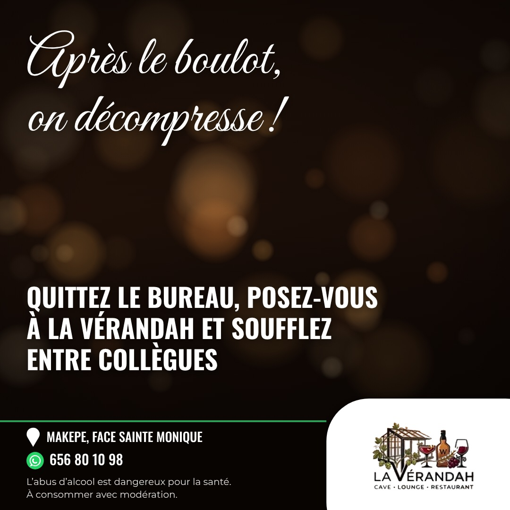

**Visuel :** Après le boulot, on décompresse ! — QUITTEZ LE BUREAU, POSEZ-VOUS À LA VÉRANDAH ET SOUFFLEZ ENTRE COLLÈGUES

**Légende à publier :**

```text
Milieu de semaine, dossiers qui s'empilent, journées qui n'en finissent pas… Vous méritez une vraie pause ! 😌 Après le travail, retrouvez vos collègues ou vos amis à La Vérandah. Installez-vous, choisissez une Guinness, une Heineken ou un verre de vin, et prenez le temps de souffler.

On vous attend à Makepe, en face de l'église Sainte Monique. Appels et WhatsApp : 656 80 10 98. 📍

L'abus d'alcool est dangereux pour la santé. À consommer avec modération.

#LaVerandah #Douala #Makepe #ApresLeTravail #Lounge
```

### Jeudi 18h — La cave · Les whiskies de la cave

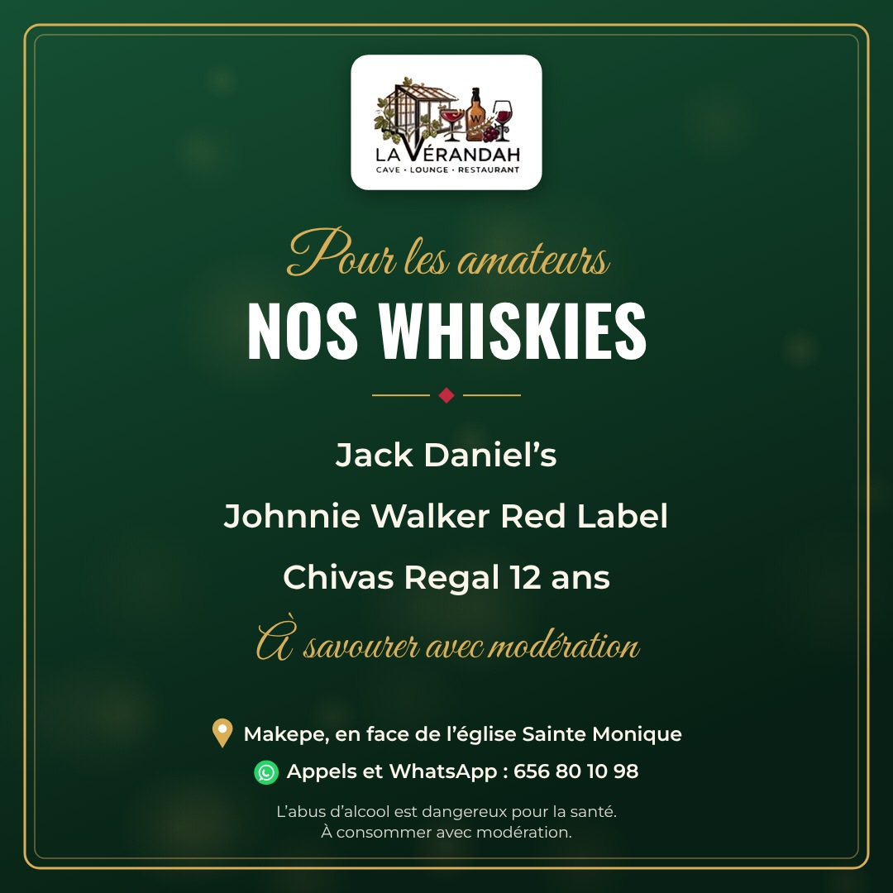

**Visuel :** Pour les amateurs — NOS WHISKIES — À savourer avec modération

1. Jack Daniel's
2. Johnnie Walker Red Label
3. Chivas Regal 12 ans

**Légende à publier :**

```text
Jack Daniel's, Johnnie Walker Red Label ou Chivas Regal 12 ans : à La Vérandah, chacun choisit le sien. 🥃

Après le travail ou le week-end, venez vous poser entre amis et prendre le temps de savourer. On vous attend à Makepe, en face de l'église Sainte Monique. Appels et WhatsApp : 656 80 10 98. 📍

L'abus d'alcool est dangereux pour la santé. À consommer avec modération.

#LaVerandah #Douala #Makepe #Whisky #CaveAVin
```

### Vendredi 16h — Photo pleine page · Invitation pour le week-end (vendredi)

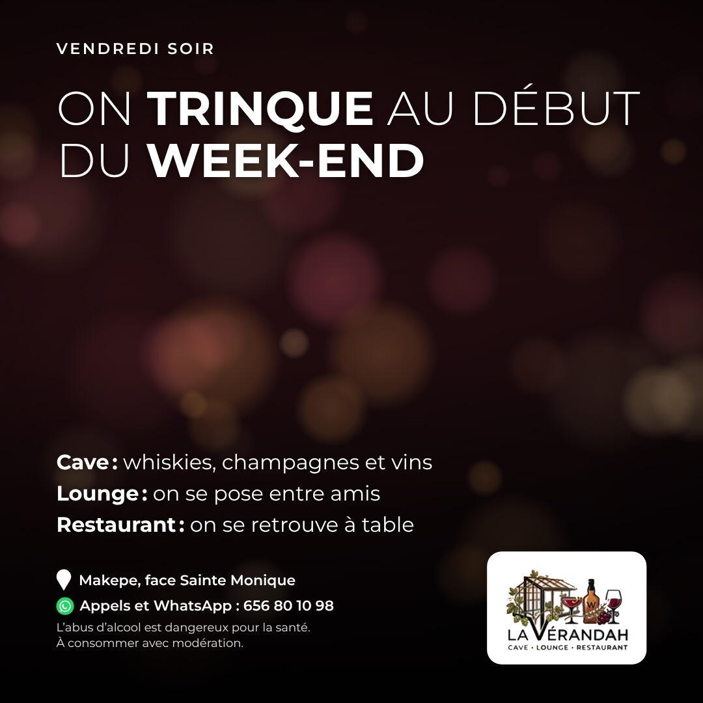

**Visuel :** Vendredi soir — On trinque au début du week-end

1. Cave : whiskies, champagnes et vins
2. Lounge : on se pose entre amis
3. Restaurant : on se retrouve à table

**Légende à publier :**

```text
Vendredi, c'est le jour où l'on souffle enfin. 🙌 La semaine est bouclée, les dossiers peuvent attendre : place aux retrouvailles. Ce soir entre collègues, demain entre amis ou en famille, venez vous poser à La Vérandah. Bière, whisky, vin ou champagne : chacun y trouve son plaisir.

Bon week-end à tous ! On vous attend à Makepe, en face de l'église Sainte Monique. Appels et WhatsApp : 656 80 10 98. 📍

L'abus d'alcool est dangereux pour la santé. À consommer avec modération.

#LaVerandah #Douala #Makepe #BonWeekEnd #Lounge
```

### Samedi 11h — La cave · Les champagnes pour les grandes occasions


**Visuel :** On fête ça ! — LES GRANDES OCCASIONS — Pour lever son verre

1. Champagne Moët & Chandon
2. Champagne Ruinart
3. Vins rouges, blancs et rosés

**Légende à publier :**

```text
Un anniversaire, une réussite, une bonne nouvelle à fêter ? Les grandes occasions méritent leurs bulles. 🥂

Moët & Chandon ou Ruinart pour lever son verre, nos vins rouges, blancs et rosés pour accompagner le moment : venez trinquer entre amis à La Vérandah, à Makepe, en face de l'église Sainte Monique. Appels et WhatsApp : 656 80 10 98.

L'abus d'alcool est dangereux pour la santé. À consommer avec modération.

#LaVerandah #Douala #Makepe #Champagne #CaveAVin
```

### Dimanche 8h — Annonce · Vœux du 1er novembre : bon mois de novembre


**Visuel :** La Vérandah vous souhaite un — BON MOIS DE NOVEMBRE

1. À toutes et à tous !

**Légende à publier :**

```text
Novembre est là ! ✨ Toute l'équipe de La Vérandah vous souhaite un mois plein de santé, de réussite et de beaux moments partagés. Merci pour votre fidélité !

Après le travail, entre amis ou en famille, prenez le temps de vous retrouver et de décompresser. Nous serons heureux de vous accueillir.

📍 Rendez-vous à Makepe, en face de l'église Sainte Monique.
📞 Appels et WhatsApp : 656 80 10 98

#LaVerandah #BonMoisDeNovembre #Douala #Makepe
```

## Pensées du promoteur

### Au choix — Pensée (photo ronde) · L'accueil, premier geste


**Visuel :** L'accueil n'est pas un geste de plus. C'est la première saveur que l'on sert à chaque table.

**Légende à publier :**

```text
Avant toute commande, il y a un bonjour, un regard, une place que l'on vous indique avec soin. C'est là que commence l'art de recevoir, et nous y tenons.

Nous vous attendons à La Vérandah, à Makepe, en face de l'église Sainte Monique, Douala. Appels et WhatsApp : 656 80 10 98

#LaVerandah #ArtDeRecevoir #Accueil #Douala
```

### Au choix — Pensée (photo ronde) · Le sourire de l'équipe


**Visuel :** Un service se mesure moins à sa rapidité qu'au sourire sincère qui l'accompagne.

**Légende à publier :**

```text
Un service rapide, c'est bien. Un service souriant, c'est ce qui reste en mémoire. Notre équipe le sait, et c'est avec ce sourire-là qu'elle vous accueille à chaque visite.

Passez nous dire bonjour à La Vérandah, à Makepe, en face de l'église Sainte Monique, Douala. Appels et WhatsApp : 656 80 10 98 😊

#LaVerandah #ServiceAvecLeSourire #Equipe #Douala
```

### Au choix — Pensée (photo ronde) · Le plaisir de se retrouver

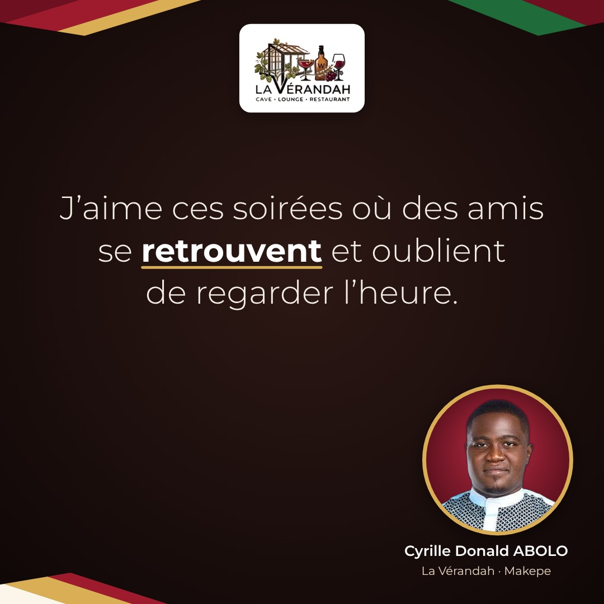

**Visuel :** J'aime ces soirées où des amis se retrouvent et oublient de regarder l'heure.

**Légende à publier :**

```text
On court toute la semaine, on se promet de se voir, puis on remet à plus tard. Pourtant, rien ne vaut ces moments où l'on se retrouve enfin, autour d'une table, pour se raconter la vie.

Ces retrouvailles, nous aimons les accueillir. Donnez-vous rendez-vous à La Vérandah, à Makepe, en face de l'église Sainte Monique, Douala. Appels et WhatsApp : 656 80 10 98 🤝

#LaVerandah #Convivialite #EntreAmis #Retrouvailles #Makepe
```

### Au choix — Pensée (photo ronde) · Prendre le temps

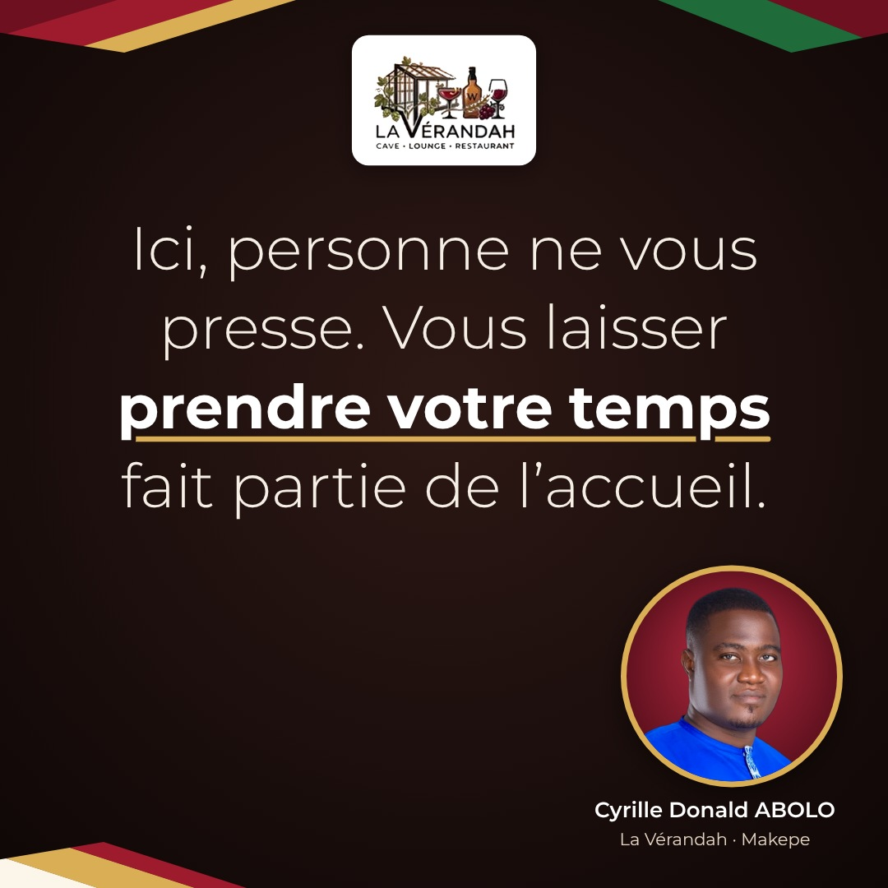

**Visuel :** Ici, personne ne vous presse. Vous laisser prendre votre temps fait partie de l'accueil.

**Légende à publier :**

```text
Pas de course, aucune pression pour libérer la table. Une fois installé, vous n'avez plus qu'à profiter : l'équipe veille à ce que rien ne vous manque.

Offrez-vous ce luxe simple, du temps pour vous et pour ceux qui vous accompagnent. On vous attend à La Vérandah, à Makepe, en face de l'église Sainte Monique, Douala. Appels et WhatsApp : 656 80 10 98

#LaVerandah #PrendreLeTemps #ArtDeRecevoir #Douala
```

### Au choix — Pensée (photo ronde) · Savourer plutôt que se presser


**Visuel :** Un bon verre se savoure sans hâte. Le vrai plaisir tient au moment partagé, jamais à la quantité.

**Légende à publier :**

```text
Savourer, c'est d'abord ralentir. On s'assoit, on parle, on goûte sans se presser, et l'on apprécie surtout d'être ensemble. La modération fait partie du plaisir.

Retrouvons-nous à La Vérandah, à Makepe, en face de l'église Sainte Monique, Douala. Appels et WhatsApp : 656 80 10 98
L'abus d'alcool est dangereux pour la santé. À consommer avec modération.

#LaVerandah #Savourer #PlaisirPartage #Moderation #Douala
```

### Au choix — Pensée (photo ronde) · Un lieu où l'on se sent bien


**Visuel :** Mon plus beau compliment ? Un invité qui s'installe, respire et me dit qu'il se sent comme chez lui.

**Légende à publier :**

```text
On peut soigner le décor, la carte, chaque détail. Mais ce qui fait vraiment un lieu, c'est ce qu'on y ressent en arrivant : la sensation d'être attendu et d'avoir trouvé sa place.

C'est ce que nous cherchons à vous offrir chaque jour. Venez le ressentir à La Vérandah, à Makepe, en face de l'église Sainte Monique, Douala. Appels et WhatsApp : 656 80 10 98 🏡

#LaVerandah #CommeALaMaison #SeSentirBien #Makepe
```

## Jeudi 29 octobre

### Jeudi 16h30 — Pensée (photo ronde) · motivation du jeudi

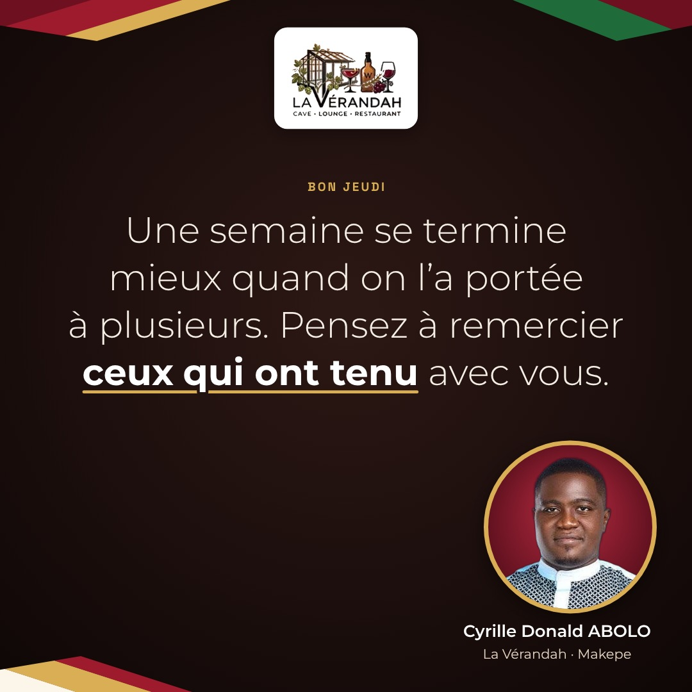

**Visuel :** Bon jeudi — Une semaine se termine mieux quand on l'a portée à plusieurs. Pensez à remercier ceux qui ont tenu avec vous.

**Légende à publier :**

```text
Derrière chaque semaine réussie, il y a un collègue qui a donné un coup de main, un proche qui a patienté, un ami qui a appelé au bon moment. Un merci sincère, dit en face, vaut plus qu'un long message.

Venez le leur dire à La Vérandah, à Makepe, en face de l'église Sainte Monique, Douala. Appels et WhatsApp : 656 80 10 98

#LaVerandah #Douala #Makepe #Gratitude #BonJeudi
```

### Jeudi 7h30 — Pensée (photo ronde) · motivation du jeudi


**Visuel :** Pensée du jeudi — Le jeudi, on est tenté de bâcler pour aller plus vite. Pourtant, on ne se repose vraiment qu'après un travail bien fini.

**Légende à publier :**

```text
Quand la semaine pèse, on a envie d'expédier les dernières tâches. Prenez plutôt le temps de les terminer avec soin : c'est ce qui permet ensuite de souffler l'esprit tranquille, sans rien laisser traîner derrière soi.

Pour ce moment de répit, nous vous attendons à La Vérandah, à Makepe, en face de l'église Sainte Monique, Douala. Appels et WhatsApp : 656 80 10 98

#LaVerandah #Douala #Makepe #TravailBienFait #BonJeudi
```

## Citations

### Au choix — Pensée (photo ronde) · citation · Albert Einstein (lettre à son fils Eduard, 5 février 1930)

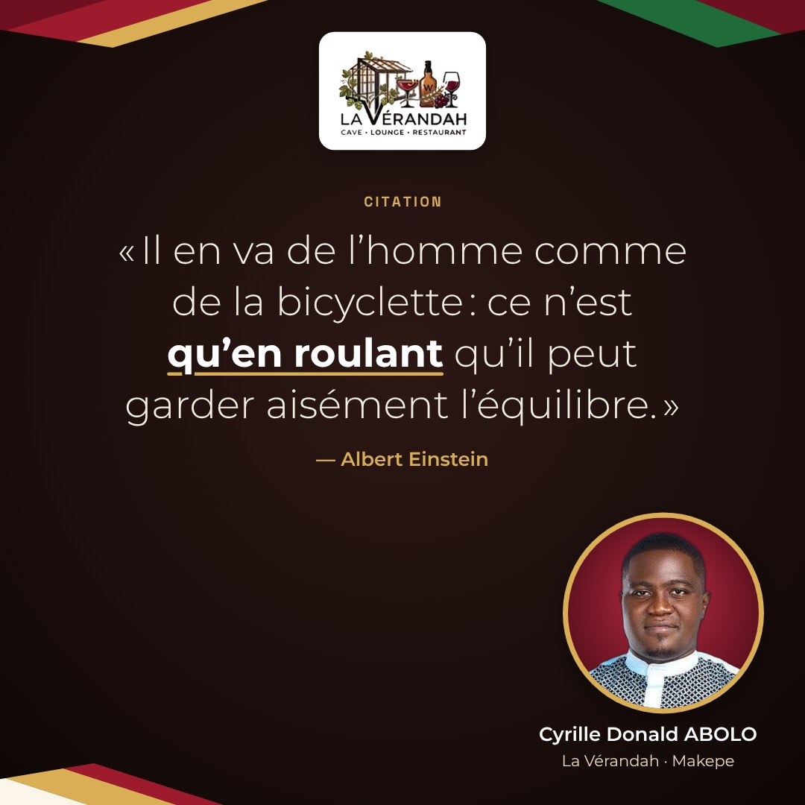

**Visuel :** Citation — « Il en va de l'homme comme de la bicyclette : ce n'est qu'en roulant qu'il peut garder aisément l'équilibre. »

**Légende à publier :**

```text
« Il en va de l'homme comme de la bicyclette : ce n'est qu'en roulant qu'il peut garder aisément l'équilibre. » — Albert Einstein, dans une lettre à son fils Eduard (1930). Avancer, même à petit rythme, c'est déjà trouver son équilibre.

Le temps d'une pause, retrouvez-nous à La Vérandah, à Makepe, en face de l'église Sainte Monique, Douala. Appels et WhatsApp : 656 80 10 98.

#LaVerandah #Douala #Makepe #Motivation #CitationDuJour
```

### Au choix — Pensée (photo ronde) · citation · Guillaume Apollinaire (Les Mamelles de Tirésias, prologue, 1917)

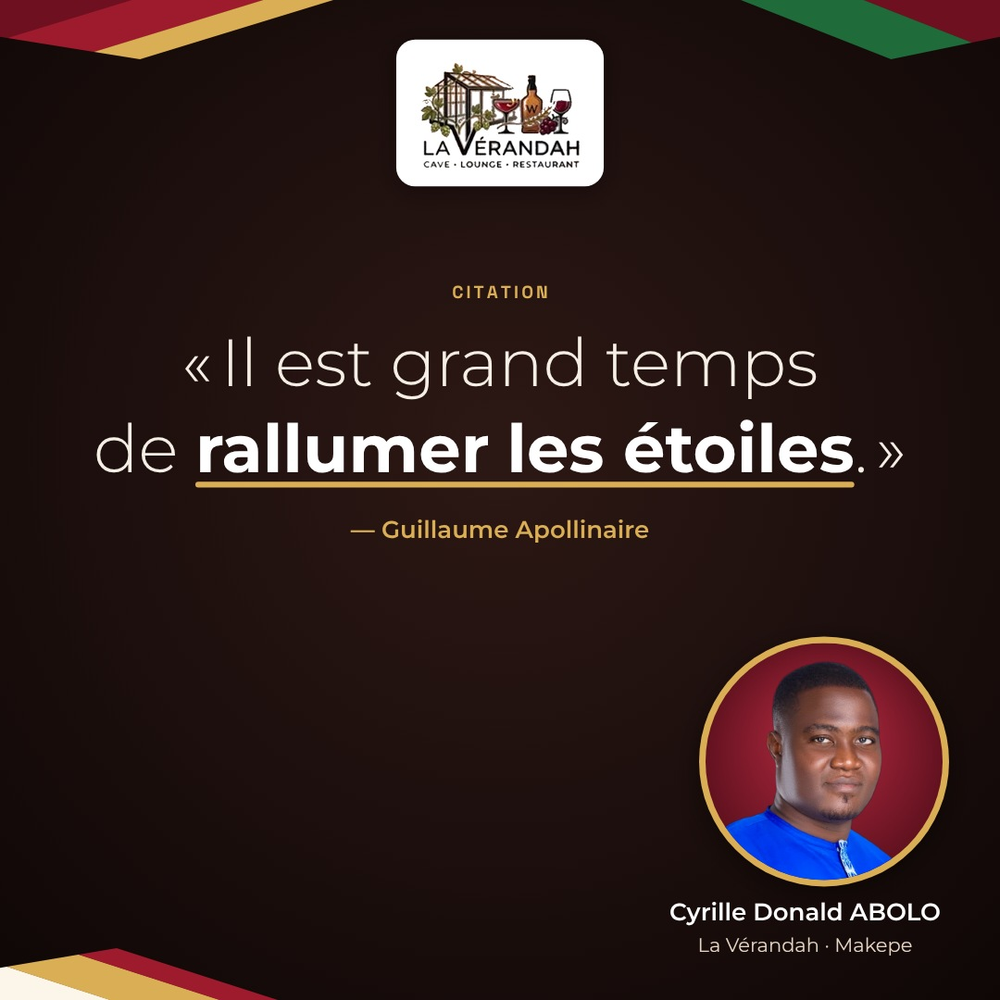

**Visuel :** Citation — « Il est grand temps de rallumer les étoiles. »

**Légende à publier :**

```text
« Il est grand temps de rallumer les étoiles. » — Guillaume Apollinaire, prologue des Mamelles de Tirésias (1917). Chacun porte en soi une petite lumière : à nous de la faire briller de nouveau, pour soi et pour ceux qu'on aime.

Nous vous attendons à La Vérandah, à Makepe, en face de l'église Sainte Monique, Douala. Appels et WhatsApp : 656 80 10 98.

#LaVerandah #Douala #Makepe #Inspiration #CitationDuJour
```

### Au choix — Pensée (photo ronde) · citation · Henry David Thoreau (Walden ou la Vie dans les bois, 1854, conclusion)


**Visuel :** Citation — « Si l'on avance avec confiance dans la direction de ses rêves […], on rencontrera un succès inattendu en temps ordinaire. »

**Légende à publier :**

```text
« Si l'on avance avec confiance dans la direction de ses rêves […], on rencontrera un succès inattendu en temps ordinaire. » — Henry David Thoreau, Walden ou la Vie dans les bois (1854). Vos rêves méritent qu'on leur fasse confiance, un pas après l'autre.

Pour souffler entre deux étapes, La Vérandah vous accueille à Makepe, en face de l'église Sainte Monique, Douala. Appels et WhatsApp : 656 80 10 98.

#LaVerandah #Douala #Makepe #Confiance #CitationDuJour
```

### Au choix — Pensée (photo ronde) · citation · Jacques Salomé (Le Courage d’être soi, 1999)


**Visuel :** Citation — « Ose ta vie car toi seul(e) la vivras. »

**Légende à publier :**

```text
« Ose ta vie car toi seul(e) la vivras. » — Jacques Salomé, Le Courage d'être soi (1999). Personne ne peut écrire votre histoire à votre place : prenez-en la plume avec audace et douceur.

Nous serons heureux de vous recevoir à La Vérandah, à Makepe, en face de l'église Sainte Monique, Douala. Appels et WhatsApp : 656 80 10 98.

#LaVerandah #Douala #Makepe #Audace #CitationDuJour
```

### Au choix — Pensée (photo ronde) · citation · Sénèque (Lettres à Lucilius, lettre 104)


**Visuel :** Citation — « Ce n'est pas parce que les choses sont difficiles que nous n'osons pas, c'est parce que nous n'osons pas qu'elles sont difficiles. »

**Légende à publier :**

```text
« Ce n'est pas parce que les choses sont difficiles que nous n'osons pas, c'est parce que nous n'osons pas qu'elles sont difficiles. » — Sénèque, Lettres à Lucilius (lettre 104). Le premier pas allège souvent la route : osez-le dès aujourd'hui.

Passez nous voir à La Vérandah, à Makepe, en face de l'église Sainte Monique, Douala. Appels et WhatsApp : 656 80 10 98.

#LaVerandah #Douala #Makepe #Oser #CitationDuJour
```

### Au choix — Pensée (photo ronde) · citation · Platon (Les Lois, livre I (trad. Victor Cousin))


**Visuel :** Citation — « La première et la plus excellente des victoires est celle qu'on remporte sur soi-même. »

**Légende à publier :**

```text
« La première et la plus excellente des victoires est celle qu'on remporte sur soi-même. » — Platon, Les Lois, livre I. Chaque jour offre une occasion de se dépasser un peu, sans bruit et sans se comparer aux autres.

Venez savourer vos petites victoires à La Vérandah, à Makepe, en face de l'église Sainte Monique, Douala. Appels et WhatsApp : 656 80 10 98.

#LaVerandah #Douala #Makepe #Depassement #CitationDuJour
```

## Novembre bleu

### Novembre — Citation · Novembre bleu · cancer de la prostate

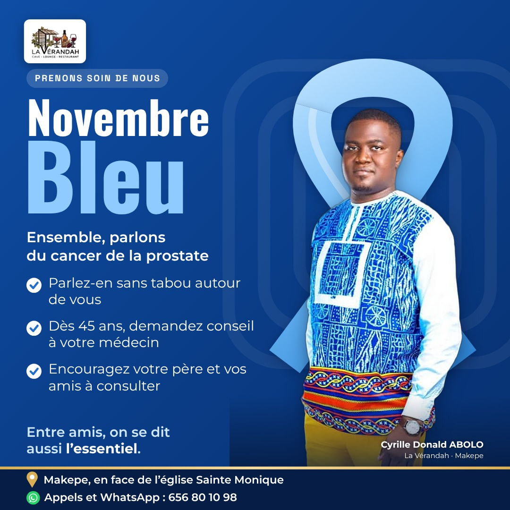

**Visuel :** Prenons soin de nous — Novembre bleu — Ensemble, parlons du cancer de la prostate

1. Parlez-en sans tabou autour de vous
2. Dès 45 ans, demandez conseil à votre médecin
3. Encouragez votre père et vos amis à consulter

**Légende à publier :**

```text
💙 Chers amis, novembre se met au bleu ! C’est le mois de sensibilisation au cancer de la prostate, le plus fréquent chez l’homme au Cameroun, selon l’OMS. Un geste simple : en parler sans tabou et, dès 45 ans (40 ans s’il y a des cas dans la famille), demander conseil à son médecin.

Toute la maison pense à ceux qui traversent la maladie et à leurs proches. Prenez soin de vous et de ceux que vous aimez.
La Vérandah, Makepe, en face de l’église Sainte Monique, Douala. Appels et WhatsApp : 656 80 10 98.

#NovembreBleu #LaVerandah #Douala #CancerDeLaProstate #Makepe
```

## Mercredi 4 novembre

### Mercredi 17h — Pensée (photo ronde) · milieu de semaine


**Visuel :** Bon mercredi — Au milieu de la semaine, un repas partagé remet souvent les idées en place. Accordez-vous ce temps.

**Légende à publier :**

```text
Mercredi : la semaine est à moitié faite et la fatigue commence à se faire sentir. Un bon repas, une conversation entre collègues ou entre amis, et l’on repart souvent avec les idées plus claires.

Nous vous attendons à La Vérandah, à Makepe, en face de l’église Sainte Monique, Douala. Appels et WhatsApp : 656 80 10 98

#LaVerandah #Douala #Makepe #BonMercredi #Partage
```

## Jeudi 5 novembre

### Jeudi 17h — Pensée (photo ronde) · citation · La Fontaine, L’Âne et le Chien

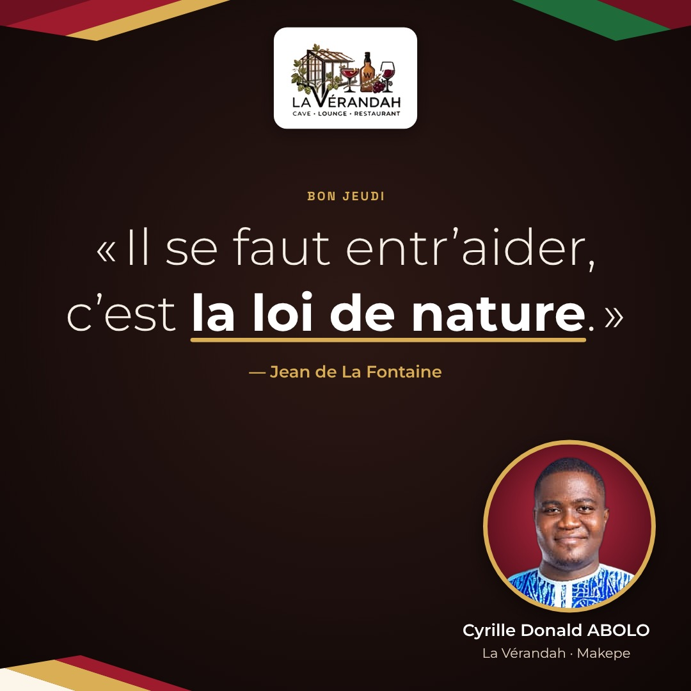

**Visuel :** Bon jeudi — « Il se faut entr’aider, c’est la loi de nature. »

**Légende à publier :**

```text
« Il se faut entr’aider, c’est la loi de nature. » Le premier vers de la fable « L’Âne et le Chien », de Jean de La Fontaine. Un collègue qui donne un coup de main, un ami qui écoute, un voisin qui rend service : c’est souvent ce qui fait tenir la semaine.

Retrouvons-nous à La Vérandah, à Makepe, en face de l’église Sainte Monique, Douala. Appels et WhatsApp : 656 80 10 98

#LaVerandah #Douala #Makepe #BonJeudi #Entraide
```

## Le conseil de la cave — au choix

### Au choix — Pensée (photo ronde) · température du vin rouge

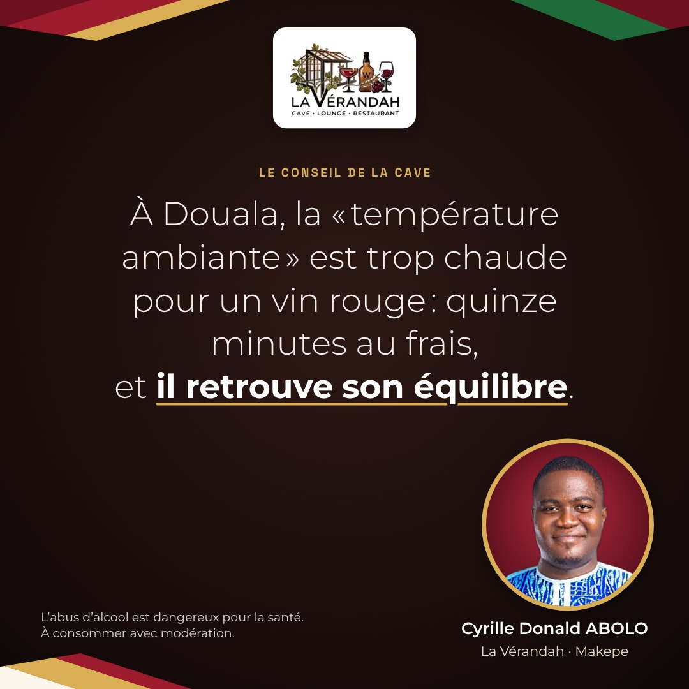

**Visuel :** Le conseil de la cave — À Douala, la « température ambiante » est trop chaude pour un vin rouge : quinze minutes au frais, et il retrouve son équilibre.

**Légende à publier :**

```text
Le vin rouge se sert en général entre 14 et 18 °C selon le vin. Dans nos salles à 28 °C, il paraît vite lourd et l’alcool ressort. Quelques minutes au réfrigérateur ou dans un seau d’eau fraîche suffisent pour lui rendre son fruit.

Retrouvez-nous à La Vérandah, à Makepe, en face de l’église Sainte Monique, Douala. Appels et WhatsApp : 656 80 10 98
L’abus d’alcool est dangereux pour la santé. À consommer avec modération.

#LaVerandah #Douala #Makepe #ConseilVin #Moderation
```

### Au choix — Pensée (photo ronde) · service du champagne

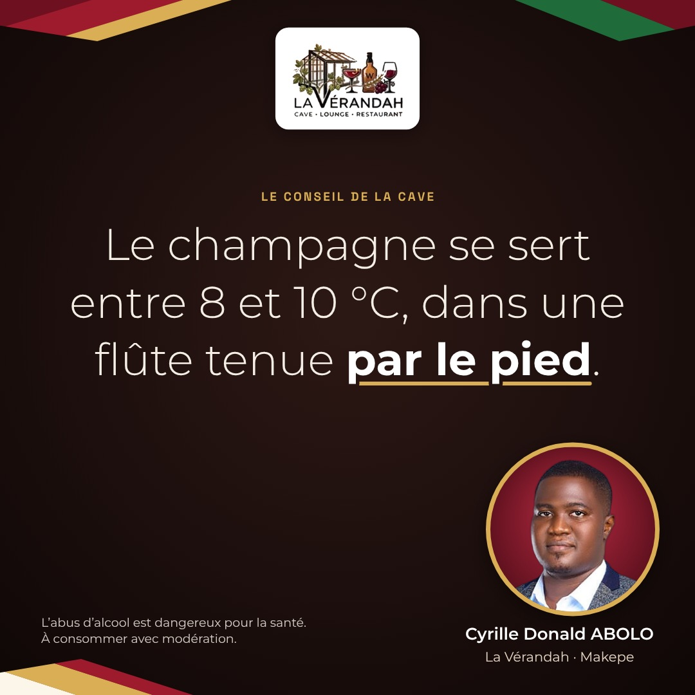

**Visuel :** Le conseil de la cave — Le champagne se sert entre 8 et 10 °C, dans une flûte tenue par le pied.

**Légende à publier :**

```text
Trop froid, le champagne perd ses arômes ; trop chaud, la mousse déborde. Entre 8 et 10 °C, il est à son meilleur. Et tenir la flûte par le pied évite de réchauffer le vin avec la main.

Retrouvez-nous à La Vérandah, à Makepe, en face de l’église Sainte Monique, Douala. Appels et WhatsApp : 656 80 10 98
L’abus d’alcool est dangereux pour la santé. À consommer avec modération.

#LaVerandah #Douala #Champagne #ArtDeRecevoir #Moderation
```

### Au choix — Pensée (photo ronde) · consommation responsable


**Visuel :** Le conseil de la cave — Entre deux verres, un verre d’eau : le secret d’une soirée réussie.

**Légende à publier :**

```text
Un verre d’eau entre deux verres, c’est le geste simple des bonnes soirées : on savoure mieux, on profite plus longtemps de la compagnie, et l’on rentre en forme. Sans oublier la règle d’or : celui qui conduit ne boit pas.

Retrouvez-nous à La Vérandah, à Makepe, en face de l’église Sainte Monique, Douala. Appels et WhatsApp : 656 80 10 98
L’abus d’alcool est dangereux pour la santé. À consommer avec modération.

#LaVerandah #Douala #Makepe #Moderation #SoireeReussie
```

### Au choix — Pensée (photo ronde) · dégustation du whisky

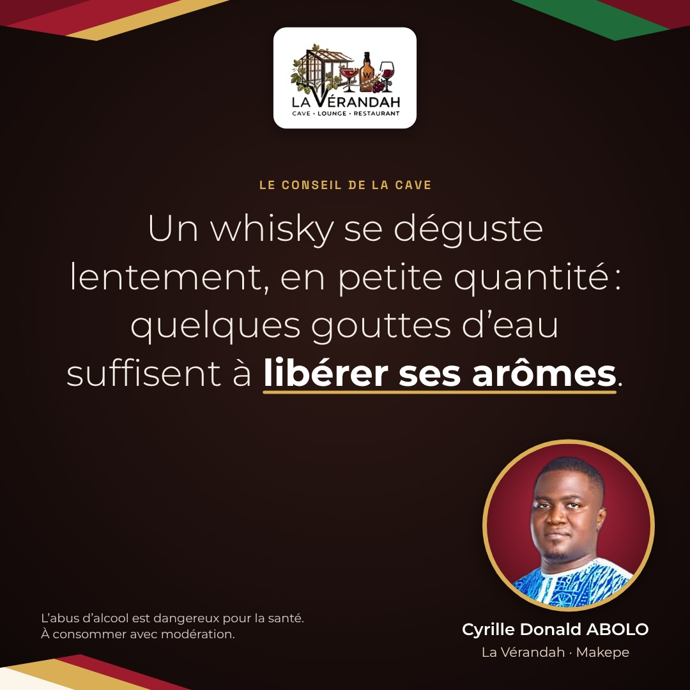

**Visuel :** Le conseil de la cave — Un whisky se déguste lentement, en petite quantité : quelques gouttes d’eau suffisent à libérer ses arômes.

**Légende à publier :**

```text
Le whisky ne se boit pas d’un trait. Servi en petite quantité, il se découvre à petites gorgées ; une ou deux gouttes d’eau fraîche ouvrent ses arômes. Les glaçons, eux, le refroidissent et le diluent : à chacun de choisir, en connaissance de cause.

Retrouvez-nous à La Vérandah, à Makepe, en face de l’église Sainte Monique, Douala. Appels et WhatsApp : 656 80 10 98
L’abus d’alcool est dangereux pour la santé. À consommer avec modération.

#LaVerandah #Douala #Whisky #Degustation #Moderation
```

### Au choix — Pensée (photo ronde) · service de la bière

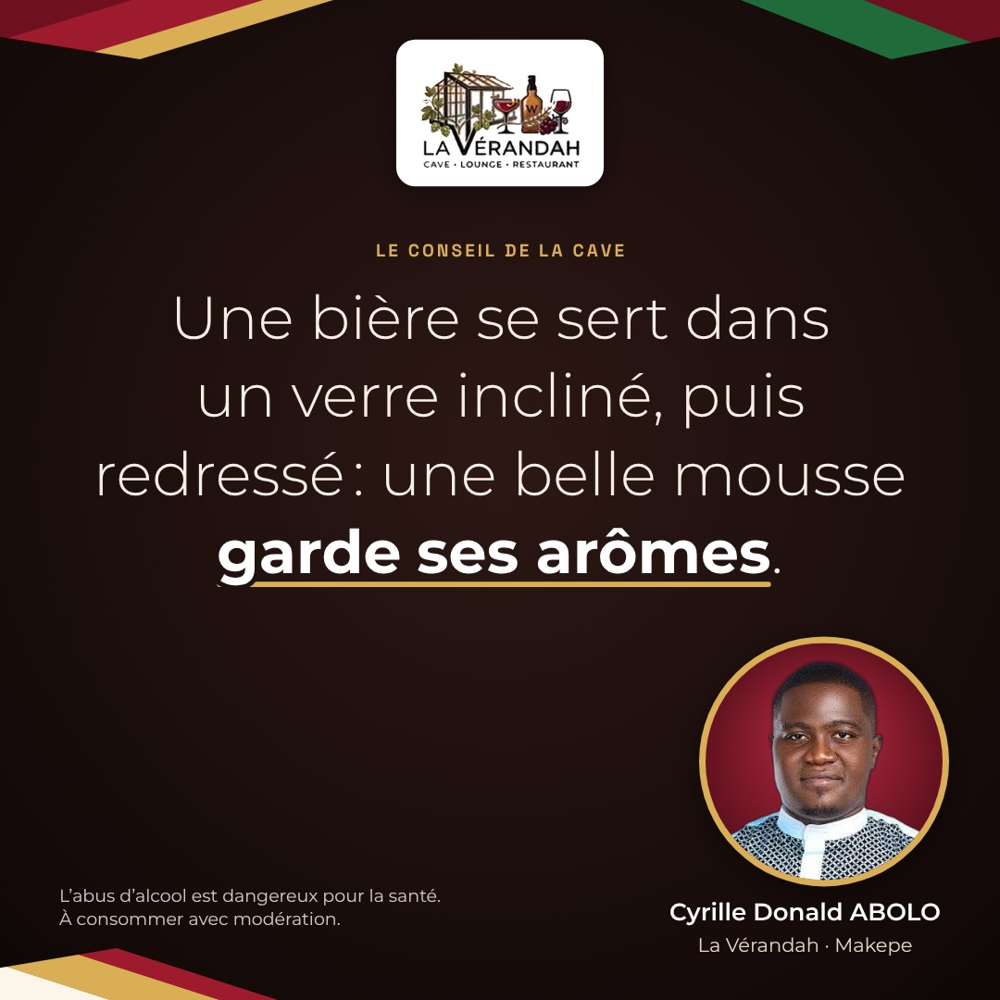

**Visuel :** Le conseil de la cave — Une bière se sert dans un verre incliné, puis redressé : une belle mousse garde ses arômes.

**Légende à publier :**

```text
Verre incliné au début, pour éviter trop de mousse ; verre redressé à la fin, pour en former un col de deux doigts. Cette mousse protège la bière et garde ses arômes jusqu’à la dernière gorgée. Et un verre bien rincé à l’eau froide fait toute la différence.

Retrouvez-nous à La Vérandah, à Makepe, en face de l’église Sainte Monique, Douala. Appels et WhatsApp : 656 80 10 98
L’abus d’alcool est dangereux pour la santé. À consommer avec modération.

#LaVerandah #Douala #Makepe #Biere #Moderation
```

### Au choix — Pensée (photo ronde) · conservation du vin

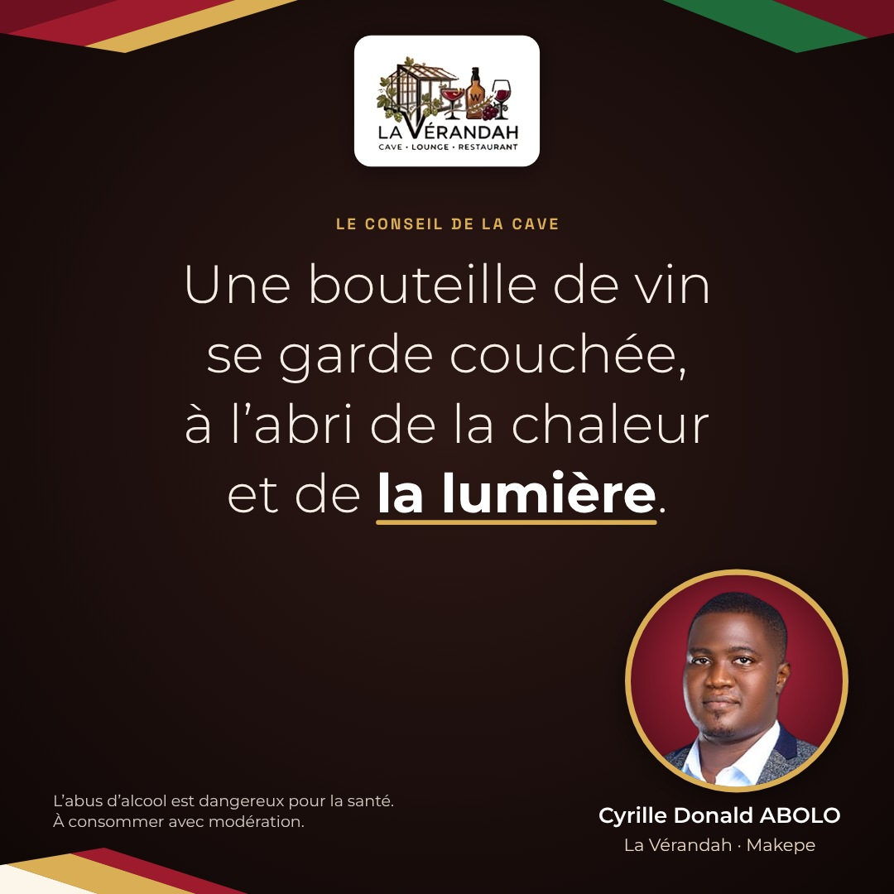

**Visuel :** Le conseil de la cave — Une bouteille de vin se garde couchée, à l’abri de la chaleur et de la lumière.

**Légende à publier :**

```text
Couchée, la bouteille garde son bouchon humide et étanche. À l’abri de la chaleur et de la lumière, le vin vieillit sans s’abîmer. À Douala, évitez la cuisine et le dessus du réfrigérateur : choisissez l’endroit le plus frais et le plus sombre de la maison.

Retrouvez-nous à La Vérandah, à Makepe, en face de l’église Sainte Monique, Douala. Appels et WhatsApp : 656 80 10 98
L’abus d’alcool est dangereux pour la santé. À consommer avec modération.

#LaVerandah #Douala #ConseilVin #Cave #Moderation
```
